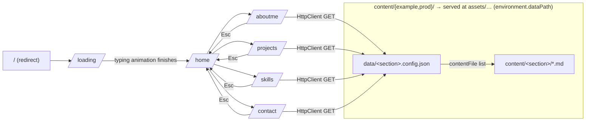

# Architecture

## Tech Stack

| Layer | Technology |
|---|---|
| Framework | Angular 20 (standalone components, no NgModules) |
| Language | TypeScript 5.8 |
| Styling | SCSS (per-component styles + global `src/styles.scss`) |
| Animations | animejs 3.x |
| Markdown rendering | ngx-markdown 20 (marked 16 under the hood) |
| HTTP | Angular HttpClient (loads content from static assets) |
| Testing | Karma + Jasmine (default Angular setup) |
| Hosting | Firebase Hosting (static SPA) |

## High-Level Overview

StarLith is a fully static single-page application. There is no backend: all
content lives as static assets (JSON configs + markdown files) that the app
fetches over HTTP at runtime and renders with ngx-markdown.



## Directory Structure

```
├── content/                             # Site content — outside src/, not app code
│   ├── example/                         # Demo content (committed to git)
│   └── prod/                            # Personal content (gitignored)
├── src/
│   ├── app/
│   │   ├── components/
│   │   │   ├── app/                    # Root component (<app-root>, router outlet)
│   │   │   ├── loading/                # Boot screen: typing console animation → /home
│   │   │   ├── home/                   # Main menu, keyboard + mouse navigation
│   │   │   ├── aboutme/                # Content section (config-driven)
│   │   │   ├── projects/               # Content section (config-driven)
│   │   │   ├── skills/                 # Content section (config-driven)
│   │   │   ├── contact/                # Content section (config-driven)
│   │   │   ├── main-menu-button/       # Reusable menu button (particles, ornamental lines)
│   │   │   ├── scan-line-effect/       # CRT scan-line visual effect
│   │   │   └── chromatic-aberration/   # SVG-filter chromatic aberration effect
│   │   ├── directives/
│   │   │   └── marquee-text/           # Overflow-aware scrolling text (sidebar menu labels)
│   │   ├── services/
│   │   │   └── typing-animation/       # Terminal-style typing animation (animejs)
│   │   ├── app.config.ts               # Providers: router, http, markdown, zone
│   │   └── app.routes.ts               # Route table
│   ├── assets/                          # Code-adjacent assets (not editable content)
│   │   ├── fonts/
│   │   ├── images/                      # Background art used by components
│   │   └── styles/                      # Global SCSS partials (variables, mixins)
│   ├── environments/                   # dataPath switch: example vs prod
│   ├── index.html
│   ├── main.ts
│   └── styles.scss
├── public/                             # Static files copied to build root (favicon, robots.txt, sitemap.xml)
├── angular.json                        # Build configs + asset mappings (content/* → assets/*)
└── firebase.json                       # Firebase Hosting config (gitignored)
```

`content/example/` and `content/prod/` are mapped into the build output at
`assets/example/` and `assets/prod/` via `angular.json`'s `assets` array —
see [CONTENT.md](CONTENT.md) for why content lives outside `src/` and how the
mapping works.

## Routing

Defined in [`src/app/app.routes.ts`](../src/app/app.routes.ts):

| Path | Component | Note |
|---|---|---|
| `/` | — | Redirects to `/loading` |
| `/loading` | `Loading` | Boot animation, auto-navigates to `/home` when done |
| `/home` | `Home` | Main menu |
| `/aboutme` | `Aboutme` | Config-driven content section |
| `/projects` | `Projects` | Config-driven content section |
| `/skills` | `Skills` | Config-driven content section |
| `/contact` | `Contact` | Config-driven content section |
| `**` | — | Redirects to `/loading` |

Every route sets a static `title`. Firebase rewrites all URLs to `index.html`,
so deep links work in production.

`Home`'s menu has 5 keyboard-navigable items: the 4 section routes above,
plus a 5th "Download CV" entry that isn't a route — activating it (click or
Enter) programmatically triggers a file download (`<a download>`) instead of
`router.navigate()`. Both paths go through one `activateItem()` method, see
[ISSUES.md](ISSUES.md), item 14.

## Content Section Components

`Aboutme`, `Projects`, `Skills`, and `Contact` share the same design (currently
as four near-identical copies — see [ISSUES.md](ISSUES.md), item 5):

1. On `ngOnInit`, fetch `<dataPath>/data/<section>.config.json` — an array of
   `{ id, title, contentFile }` entries that defines the submenu.
2. Fetch every referenced markdown file from `<dataPath>/content/<section>/` in
   parallel (`forkJoin`).
3. Render the selected file with `<markdown [data]>`.
4. On any HTTP error, fall back to hardcoded `# No Data` placeholders.

Keyboard handling is implemented with a `window:keydown` `@HostListener`:
`W`/`S`/arrows move the selection, `Esc` returns to `/home`.

Sidebar menu labels use the `MarqueeText` directive (`[appMarqueeText]`) on
the inner text span: a `ResizeObserver` compares `scrollWidth`/`clientWidth`
and toggles a `.marquee-overflowing` class + `--marquee-distance` CSS
variable only when a title genuinely doesn't fit. Short titles just sit
still; long ones get `text-overflow: ellipsis` by default and scroll on
`:hover`/`.active` via a CSS `@keyframes` animation (linear scroll left,
brief pause, instant reset — no animated return slide). One directive shared
across all 4 components, unlike the rest of their markup/logic. See
[ISSUES.md](ISSUES.md), item 18.

## Visual Effects

- **`TypingAnimation` service** — drives the loading screen: types each console
  line character-by-character with a blinking cursor (animejs-based).
- **`ScanLineEffect` component** — renders randomized horizontal CRT scan
  lines, looping opacity animation.
- **`ChromaticAberration` component** — SVG filter offsetting red/blue
  channels with a "breathing" animation; intensity configurable via `@Input`.
- **`MainMenuButton` component** — home menu button with activation timeline
  (ornamental lines, dots) and looping particle animation.

## Environments & Content Switching

The only environment difference is which content folder is served:

| File | `production` | `dataPath` |
|---|---|---|
| `environment.ts` (default / development) | `false` | `assets/example/` |
| `environment.prod.ts` (production build) | `true` | `assets/prod/` |
| `environment.test.ts` (test config) | `false` | `assets/example/` |

`angular.json` swaps the file via `fileReplacements` in the `production` and
`test` build configurations. See [DEPLOYMENT.md](DEPLOYMENT.md).
